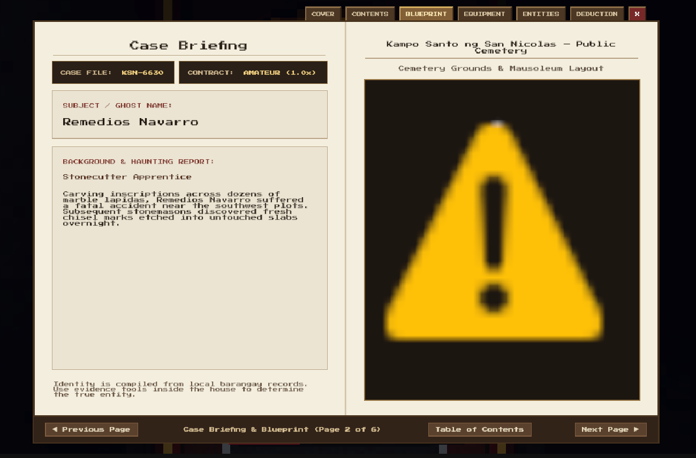

# Pamahiin — Philippine Cemetery Map Plan (`CemeteryMap`)

## Goal
Build **Kampo Santo ng San Nicolas — Public Cemetery** (`Assets/Scenes/CemeteryMap.unity`), a new pure top-down 16-bit playable contract map roughly **2x the surface area of `BarangayMap`** (`8.50 x 6.50` world-unit walled cemetery compound plus west asphalt road), featuring authentic Filipino *sementeryo* architecture, single-sprite rusty wrought-iron gate, Caretaker's *Bantay* Shed, tight multi-tiered *nitso* maze rows, enclosed family mausoleums, classic grass burial plots, animated flickering gravestone candles, whole-map outdoor dynamic weather (with fireflies attracted to light sources), Journal blueprint + cemetery case lore, and retirement of the legacy `Abandoned House (Original Prototype)` map entry.

---

## Target Directories & Files for Argon (Read Only These First to Minimize Token Usage)

> **Argon Scope Rule:** Do **not** scan the whole repository. Only inspect the exact files below when implementing each phase.

### Reference Templates & Importers (Read Before Asset / Scene Building)
- `Assets/Editor/BarangayAssetGenerator.cs` — `PixelCanvas` helper, 16-bit mahogany/slate/brass palette, PNG saving patterns.
- `Assets/Editor/BarangayTextureImporter.cs` — `AssetPostprocessor` rules (`Point`, `Uncompressed`, PPU, `Repeat` wrap mode, `isReadable`).
- `Assets/Editor/BarangayBlueprintGenerator.cs` — `840x980` dark mahogany & brass blueprint PNG generator pattern.
- `Assets/Editor/BarangayMapSceneBuilder.cs` — `GameMapScene.unity` cloning, `FixVanAndKeyLayout`, `CreateNetworkDoor`, `CreateRoomLightingAndSwitch`, `BuildGhostNodeGraph`, `CreateBurialMapStage`, `BakeNavMeshAndLink`.
- `Assets/Editor/BarangayMapFixer.cs` — `BakeAndPersistNavMeshSurface(NavMeshSurface, string scenePath)`.
- `Assets/Resources/Sprites/BarangayMap/` — Reusable sprites (`Exterior/`, `House/`, `House/Furniture/`, `Props/`, `Jeepney/`, `Weather/`, `Burial/`).

### Runtime Systems to Extend / Integrate
- `Assets/Scripts/WeatherManager.cs` — Parameterize outdoor weather bounds, full-map rain/fog/puddle spawning, and light-source firefly anchoring.
- `Assets/Scripts/GhostHandler.cs` & `Assets/Scripts/HunterGhostBehavior.cs` — Support outdoor cemetery investigation bounds alongside enclosed `RoofFader` buildings.
- `Assets/Scripts/GameAudioManager.cs` — Gate `IsBasementPosition()` so single-level maps never trigger false basement muffling.
- `Assets/Scripts/GhostPropInteractable.cs` — Support loading `Sprites/CemeteryMap/...` prop sheets cleanly.
- `Assets/Scripts/ProgressionAndLoadoutManager.cs` — Register `CemeteryMap`, retire `Abandoned House (Original Prototype)` from `AvailableMaps`.
- `Assets/Scripts/GameMatchManager.cs` — Add cemetery-specific `KSN-####` case IDs and haunting background templates.
- `Assets/Scripts/NetworkController.cs` — Generalize loading intermission strings (no hardcoded `"Barangay"` when loading Cemetery).
- `Assets/Scripts/UI/JournalController.cs` & `Assets/UI/Journal/JournalUI.uss` — Bind `.blueprint-cemetery` and cemetery subtitle/metadata.

### Validation & Build Registry
- `ProjectSettings/EditorBuildSettings.asset` — Register `Assets/Scenes/CemeteryMap.unity`.
- `Assets/Tests/EditMode/UIThemeAuditTests.cs` — USS compliance rules (`0px` radius, no `scale`, `-unity-font-style: normal`, `@import PamahiinTheme.uss`).
- `Assets/Scenes/GameMapScene.unity` — **Keep on disk** as the scene-cloning template used by `BarangayMapSceneBuilder` and `CemeteryMapSceneBuilder` (do not delete).

---

## World Coordinate Blueprint (`8.50 x 6.50` Compound + West Road)

All coordinates are pure 90-degree top-down 2D (`Z = 0`, `+Y = North`, `+X = East`) and stay well away from `BurialMapStage.STAGE_CENTER` at `(25, 25, 0)`.

| Sector | World Bounds `(xMin..xMax, yMin..yMax)` | Key Contents |
|---|---|---|
| **West Road & Jeepney** | `x=[-1.72..-0.34]`, `y=[-3.15..+3.45]` | Reused `asphalt_road`, `Jeepney` (`Van` moved to `(-0.82, 0.28)`), `ParkedTricycle`, `LampPost_0..5`, road `TrashScatter`, `WeatherPuddle`, `StreetBoundary` colliders (`area=1` Not Walkable). |
| **Entrance Apron** | `x=[-0.34..0.00]`, `y=[-0.14..+0.38]` | `floor_porch_tile`, `SurfaceType.Concrete`, `NavMeshModifier(area=1)` connecting road curb to `FrontGate` at `(0.00, 0.12)`. |
| **Cemetery Perimeter Walls** | `x=[0.00..8.50]`, `y=[-3.10..+3.40]` | Reuses `wall_concrete_top` (`wt=0.06`, `ShadowCaster2D`, `NavMeshModifier(area=1)`). West wall leaves `0.50` gap (`y=[-0.13..+0.37]`) for `FrontGate`. |
| **Main Stone Avenues & Central Cross Plaza** | E–W: `x=[0.00..8.35], y=[-0.16..+0.40]`<br>N–S: `x=[3.80..4.36], y=[-2.95..+3.25]`<br>Plaza: `x=[3.53..4.63], y=[-0.43..+0.67]` | `cemetery_path_stone` (`SurfaceType.Concrete`, `priority=2`, `area=0` Walkable). Central cross monument (`cemetery_cross_monument`), candle ring, stone benches, `HideZone_CentralCross`. |
| **Caretaker's *Bantay* Shed** | `Rect(0.22, -1.75, 1.45, 1.10)` | Enclosed building: `floor_garage_concrete`, `wall_concrete_top`, `window_frame_top`, `roof_main_gi` + `RoofFader(enclosedBuilding=true)`, `BantayShed_Door` at `(0.95, -0.65)`. Contains **`FuseBox`** at `(0.36, -1.18)`, **`BantayShed LS`** at `(0.76, -0.74)`, `BantayShed_SafeZone`, `furn_desk`, `HideZone_BantayShedDesk`, props, `GhostRoomMarker`. |
| **Caretaker Yard & Vendor Stall** | South Yard: `x=[0.18..1.90], y=[-3.00..-1.80]`<br>Gate Stall: `Rect(0.25, 0.78, 1.15, 0.72)` | `Poso` water pump `(0.55, -2.25)`, Caretaker tricycle/handcart `(1.42, -2.35)` + `HideZone_CaretakerCart`; Flower & Candle Stall near North entrance with breakable vases, jars, candles, `HideZone_FlowerStall`. |
| **Classic Grass Burials & Balete Grove** | NW Grass: `x=[0.18..3.72], y=[+0.48..+3.28]`<br>SW Grass: `x=[1.98..3.72], y=[-3.00..-0.24]` | `cemetery_grass` (`SurfaceType.Grass`), gravestones/obelisk crosses (`ShadowCaster2D` + `area=1`), flat *lapida* slabs, raised tombs, animated candles on gravestones, gnarled Balete/Acacia trees with `HideZone_BaleteNorth` & `HideZone_AcaciaSouth`, `NorthGrassPath LS` walkway floodlights. Ghost Rooms: `NorthGrassBurial`, `BaleteGrove`, `SouthwestGrassPlots`. |
| **Multi-Tiered *Nitso* Maze** | NE Sector: `x=[4.45..8.38], y=[+0.48..+3.28]` | Tight maze of 6+ concrete *nitso* wall blocks (`cemetery_nitso_block`, `0.28–0.32` thick, `ShadowCaster2D`, `area=1` Not Walkable) separated by `0.44–0.50` wide dirt alleys (`cemetery_dirt_alley`, `area=0` Walkable), cross-passages, alcove `HideZone`s, alley clutter, candles in niche ledges, `NitsoAlley LS` floodlights. Ghost Rooms: `NitsoMaze_West`, `NitsoMaze_East`. |
| **Old Family Mausoleums (x3)** | SE Sector: `x=[4.45..8.38], y=[-3.02..-0.24]` | 3 enclosed stone mausoleums separated by stone lanes:<br>1. `Mausoleum_DelosSantos` (`Rect(4.55, -1.48, 1.65, 1.20)`): iron entry gate (`gate_iron.png`), `cemetery_roof_concrete` + `RoofFader(enclosedBuilding=true)`, `cemetery_mausoleum_tile`, `cemetery_altar`, benches (`HideZone`), candles, `Mausoleum1 LS` + `SafeZone`.<br>2. `Mausoleum_Villanueva` (`Rect(6.55, -1.48, 1.75, 1.20)`): wooden door (`door_wood_closed`/`open`), `roof_main_gi` + `RoofFader(enclosedBuilding=true)`, `floor_bathroom_tile`, altar, candles, `Mausoleum2 LS` + `SafeZone`.<br>3. `Mausoleum_AbandonedCrypt` (`Rect(5.20, -2.96, 2.35, 1.18)`): wooden door, `cemetery_roof_concrete` + `RoofFader(enclosedBuilding=true)`, `floor_porch_tile`, altar, stone pillars (`furn_pillar`), props, `HideZone`, `Mausoleum3 LS` + `SafeZone`. |

---

## Asset Plan (Reuse vs. New Generation)

### 1. Assets Reused from `Assets/Resources/Sprites/BarangayMap/`
- **Exterior & Road**: `Exterior/asphalt_road`, `Exterior/lamp_post`, `Exterior/trash_scatter`, `Exterior/tricycle_topdown`.
- **Architecture & Doors**: `House/wall_concrete_top`, `House/roof_main_gi`, `House/floor_garage_concrete`, `House/floor_porch_tile`, `House/floor_bathroom_tile`, `House/door_wood_closed`, `House/door_wood_open`, `House/window_frame_top`.
- **Furniture & Props**: `House/Furniture/furn_fusebox`, `House/Furniture/furn_desk`, `House/Furniture/furn_pillar`, `Props/prop_chair_sheet`, `Props/prop_cup_sheet`, `Props/prop_glass_bottle_sheet`, `Props/prop_picture_frame_sheet`, `Props/prop_paint_can_sheet`.
- **Jeepney, Weather & Burial**: All `Jeepney/*`, `Weather/*`, and `Burial/*` sprites.

### 2. New Assets to Generate in `Assets/Editor/CemeteryAssetGenerator.cs`
Save all new sprites under `Assets/Resources/Sprites/CemeteryMap/`:
- `gate_iron.png` (`64x16`, 1 single sprite): rusty wrought-iron gate with vertical spear bars, middle lock plate, and hinge post. Used for **both** `ClosedRef` and `OpenRef` (no separate closed/open sprite assets).
- `candle_sheet.png` (`64x16`, 4 horizontal `16x16` frames): small candle clusters with flickering flame animation frames.
- Tileable grounds & roofs: `cemetery_grass.png` (`64x64`), `cemetery_dirt_alley.png` (`64x64`), `cemetery_path_stone.png` (`64x64`), `cemetery_mausoleum_tile.png` (`64x64`), `cemetery_roof_concrete.png` (`128x128`).
- Cemetery structures & landmarks: `cemetery_nitso_block.png` (`64x32`), `cemetery_gravestone_1.png` (`24x24`), `cemetery_gravestone_2.png` (`24x28`), `cemetery_lapida_flat.png` (`32x24`), `cemetery_tomb_raised.png` (`32x40`), `cemetery_altar.png` (`40x24`), `cemetery_cross_monument.png` (`40x40`), `cemetery_balete_tree.png` (`64x64`), `cemetery_flower_stall.png` (`56x32`), `cemetery_poso.png` (`24x24`), `cemetery_bench.png` (`40x16`), `cemetery_handcart.png` (`40x28`), `cemetery_trash_leaves.png` (`48x48`).
- New `GhostPropInteractable` 6-frame sheets (`144x24`, 6x `24x24` frames in `Assets/Resources/Sprites/CemeteryMap/Props/`):
  - `prop_vase_sheet.png` (breakable ceramic flower vase)
  - `prop_candle_jar_sheet.png` (breakable glass vigil candle jar)
  - `prop_watering_can_sheet.png` (non-breakable rusty tin watering can)
- Update `Assets/Editor/BarangayTextureImporter.cs`:
  - Add `CEMETERY_ROOT = "Assets/Resources/Sprites/CemeteryMap/"`.
  - Enforce `FilterMode.Point`, `Uncompressed`, `FullRect`, `npotScale = None`.
  - Set `wrapMode = Repeat` for `cemetery_grass`, `cemetery_dirt_alley`, `cemetery_path_stone`, `cemetery_mausoleum_tile`, `cemetery_roof_concrete`.
  - Set `isReadable = true` for `candle_sheet` and `CemeteryMap/Props/`.
  - Set `ppu = 128f` for `gate_iron.png`, `64f` default for all other Cemetery sprites.

### 3. New Journal Blueprint Asset (`Assets/Editor/CemeteryBlueprintGenerator.cs`)
- Generate `Assets/UI/Journal/blueprint_cemetery.png` (`840x980`, `PxPerUnit = 142f`, matching `BarangayBlueprintGenerator`'s dark mahogany & brass schematic aesthetic) showing the Cemetery perimeter, Front Gate, Bantay Shed, Grass Plots, Nitso Maze, and 3 Family Mausoleums with crisp labels.

---

## Detailed Implementation Phases for Argon

### Phase 1 — Core Runtime Extensions (Backwards-Compatible with `BarangayMap`)
1. **Outdoor Investigation Bounds (`Assets/Scripts/InvestigationZone.cs` *(new)*, `GhostHandler.cs`, `HunterGhostBehavior.cs`)**:
   - Create `InvestigationZone : MonoBehaviour` requiring `Collider2D` (forced `isTrigger = true`, disables any `SpriteRenderer`), maintaining `public static readonly List<InvestigationZone> AllZones`.
   - Update `GhostHandler.IsPlayerInInvestigationArea(PlayerController p)` and `HunterGhostBehavior.IsTargetInsideAndReachable` / `ComputeInsideAndReachable`:
     - If `InvestigationZone.AllZones.Count > 0`, a position is inside the huntable investigation area if it overlaps any `InvestigationZone` **or** any enclosed `RoofFader` / basement.
     - Otherwise (e.g., `BarangayMap`), retain exact existing `RoofFader(enclosedBuilding=true)` + basement containment logic.
   - In `CemeteryMap.unity`, place an `InvestigationZone` `BoxCollider2D` covering `[0.00..8.50, -3.10..+3.40]`. The ghost will hunt players outdoors across graves and nitso alleys as well as inside the Bantay Shed and Mausoleums, while `FrontGate` (`isFrontDoor = true`, `NavMeshModifier(area=1)`) prevents the ghost from exiting onto the road or Jeepney.
2. **Basement Threshold Guard (`Assets/Scripts/GameAudioManager.cs`)**:
   - Cache `public static bool HasSceneBasement { get; private set; }` in `OnSceneLoaded` (`FindAnyObjectByType<StairTeleporter>(FindObjectsInactive.Include) != null`).
   - Change `IsBasementPosition(Vector3 worldPos)` to `HasSceneBasement && worldPos.y < BASEMENT_Y_THRESHOLD`.
3. **Whole-Map Outdoor Weather & Light-Source Fireflies (`Assets/Scripts/WeatherManager.cs`)**:
   - Add serialized configuration fields (defaulting to legacy Barangay values so `BarangayMap.unity` is unchanged):
     - `bool useCustomExteriorBounds = false`
     - `Rect[] customExteriorZones` (for `CemeteryMap`: road `(-1.72, -3.15, 1.38, 6.60)` + cemetery `[0.00, -3.10, 8.50, 6.50]`)
     - `int customFireflyCount = 128`, `int customHeroFireflyLights = 18`, `int customFogWispCount = 72`
     - `float customRainGridSpacingX = 0.58f`, `float customRainGridSpacingY = 0.54f`
     - `string[] fireflyAnchorLightPrefixes = { "LampPostLight_", "CandleLight_", "CemeteryFloodLight_" }`
   - When `useCustomExteriorBounds == true`:
     - Spawn `RainCluster_*` in a full 2D grid across all `customExteriorZones`, filtering out `IsRainBlockedPosition` (which automatically excludes `JeepneyBody`/`JeepneySafeZone` AND all enclosed `RoofFader` buildings: `BantayShed` and the 3 `Mausoleums`).
     - Spawn `FogWisp_*` across all `customExteriorZones`, filtering out `IsFogBlockedPosition` (`enclosedBuildingFogRects` + `vehicleFogExclusionRects`).
     - Anchor ~75% of fireflies around active lights matching `fireflyAnchorLightPrefixes` (`LampPostLight_*`, lit `CandleLight_*`, lit `CemeteryFloodLight_*`) and ~25% across outdoor `customExteriorZones`, keeping `IsNearRect(camRect)` culling active for smooth FPS.
     - Update `GetNearestExteriorEdgePoint(Vector3 pos)` to use the closest wall of the enclosing `RoofFader` bounds containing `pos` when `useCustomExteriorBounds` is enabled (and fallback to Barangay bounds when false).
4. **Animated Candles & Ghost Blowout (`Assets/Scripts/CemeteryCandle.cs` & `Assets/Scripts/CemeteryCandleManager.cs` *(new)*)**:
   - `CemeteryCandle`: slices `Sprites/CemeteryMap/candle_sheet` into 4 frames @ 64 PPU, animates with randomized start frame & FPS (`5.5–8.5 FPS`), gently flickers its child `CandleLight_*` `Light2D.Point` (`color=(1.0, 0.72, 0.34)`, `intensity ~0.34`, `outerRadius ~0.38`, `shadowsEnabled=false`). Keeping `"CandleLight_"` in the name ensures `GhostHandler.IsGhostRoomLit()` ignores candles.
   - `CemeteryCandleManager : NetworkBehaviour`: single `NetworkObject` manager holding a synced `NetworkVariable<ulong>` lit bitmask (`<= 64` candles) + `SetCandleLit(int id, bool lit)` + `BlowOutNearestCandle(Vector3 pos, float radius)`. Players can optionally relight extinguished candles (`[E]`), and `EventGhostBehavior` can trigger `CemeteryCandleManager.Instance?.BlowOutNearestCandle(...)` during ghost events near candles.
5. **Prop Sheet Loading (`Assets/Scripts/GhostPropInteractable.cs`)**:
   - In `EnsureSheetLoaded()`, if `spriteSheetResource` contains `"CemeteryMap/"` or `"BarangayMap/"`, load `Resources.Load<Texture2D>($"Sprites/{spriteSheetResource}")` first before falling back to `Sprites/BarangayMap/{spriteSheetResource}`.

### Phase 2 — Asset & Blueprint Generation
1. Implement `Assets/Editor/CemeteryAssetGenerator.cs` and update `Assets/Editor/BarangayTextureImporter.cs`.
2. Implement `Assets/Editor/CemeteryBlueprintGenerator.cs` to output `Assets/UI/Journal/blueprint_cemetery.png`.
3. Add Editor menu items `Pamahiin/Generate Cemetery Assets` and `Pamahiin/Generate Cemetery Blueprint`.

### Phase 3 — Scene Construction (`Assets/Editor/CemeteryMapSceneBuilder.cs`)
Add menu item `Pamahiin/Build CemeteryMap Scene`:
1. Run `BarangayAssetGenerator.GenerateAllAssets()` (ensuring reused assets exist) + `CemeteryAssetGenerator.GenerateAllAssets()` + `CemeteryBlueprintGenerator.GenerateBlueprint()`.
2. Clone `Assets/Scenes/GameMapScene.unity` -> `Assets/Scenes/CemeteryMap.unity` (just like `BarangayMapSceneBuilder`).
3. Reposition `Van` to `(-0.82, 0.28, 0)` and build `Jeepney` (`JeepneyBody`, `JeepneySafeZone`, `JeepneyBayWalkable`, `PlayerSpawnPoint`, `EquipmentSpawnPoint`, `FrontDoorKeyItem`, `TruckEndGameButton`, `TruckDashboardController`, headlights, `JeepneyRoof`, `JeepneyRampDoor`).
4. Build West Road (`asphalt_road`), `EntranceApron` (`floor_porch_tile`), `StreetBoundary_*`, `LampPost_0..5` (`LampPostLight_*`), `ParkedTricycle`, roadside `TrashScatter`, and `WeatherPuddle_*` (spread across BOTH the road AND cemetery dirt/grass low spots).
5. Build `CemeteryCompound`:
   - Ground tiles (`cemetery_grass`), stone walkways & central cross plaza (`cemetery_path_stone`), dirt nitso alleys (`cemetery_dirt_alley`).
   - Perimeter walls (`wall_concrete_top`, `ShadowCaster2D`, `NavMeshModifier(area=1)`).
   - **`FrontGate` (`NetworkDoor`)** at `(0.00, 0.12)`: `isFrontDoor = true`, `requiresKey = true`, `motionType = ArcSwing`, `swapSpriteWhenOpen = false`, `disableObstacleColliderWhenOpen = true`, using **`gate_iron.png` on BOTH `ClosedRef` and `OpenRef`** (`OpenRef` rotated `-90°` around south hinge `(0, -0.25)`), `ClosedRef` marked `NavMeshModifier(area=1)`.
   - Caretaker's *Bantay* Shed (`RoofFader(enclosedBuilding=true)`), `BantayShed_Door` (`door_wood_closed`/`open`), **`FuseBox`**, **`BantayShed LS`**, `BantayShed_SafeZone`, desk `HideZone`, caretaker yard (`Poso`, handcart/tricycle `HideZone`, flower/candle stall `HideZone`).
   - Grass burial plots, raised/flat gravestones (`ShadowCaster2D` + `area=1` on tall tombs), Balete/Acacia trees with root `HideZone`s, `NorthGrassPath LS` controlling `CemeteryFloodLight_West_*` (no `SafeZone` on outdoor floodlights).
   - *Nitso* maze (tight concrete blocks `area=1` + `0.44–0.50` dirt alleys `area=0` + alcove `HideZone`s + `NitsoAlley LS` controlling `CemeteryFloodLight_Nitso_*`).
   - 3 Old Family Mausoleums (enclosed walls, tiled floors, stone altars, benches/`HideZone`s, iron gate / wood doors, GI & concrete roofs with `RoofFader(enclosedBuilding=true)`, individual `HouseLightSwitch` + `Light2D` + `SafeZone`).
   - ~22 animated `CemeteryCandle` instances placed on gravestones, mausoleum altars, nitso ledges, and the central cross monument, managed by `CemeteryCandleManager`.
   - `GhostPropInteractable` objects inside Bantay Shed, Mausoleums, Flower Stall, and Nitso niches.
   - `GhostRoomMarker`s (9 total: `BantayShed`, `NorthGrassBurial`, `BaleteGrove`, `SouthwestGrassPlots`, `NitsoMaze_West`, `NitsoMaze_East`, `Mausoleum_DelosSantos`, `Mausoleum_Villanueva`, `Mausoleum_AbandonedCrypt`, plus `CentralCrossPlaza` — 10 total; leave `GhostHandler.ghostroomMarker = null` for random server roll).
   - Connected `GhostNode` graph (`GhostNode_0..32+`) spanning entrance, grass lanes, nitso alleys, Bantay Shed, and all 3 mausoleum interiors (starting inside `FrontGate` so the ghost never paths outside).
   - `InvestigationZone` covering `[0.00..8.50, -3.10..+3.40]`.
   - `WeatherManager` configured with `useCustomExteriorBounds = true` + road & compound rects.
   - `BurialMapStage` at `(25, 25, 0)`.
   - Bake 2D NavMesh via `BarangayMapFixer.BakeAndPersistNavMeshSurface(surface, "Assets/Scenes/CemeteryMap.unity")` (`NavhMesh` kept as first child under `Environment`; verify walkable paths into Bantay Shed, all 3 Mausoleums, and every Nitso alley, and non-walkable road/outside gate!).

### Phase 4 — Map Registration, Blueprint UI, Lore & Legacy Retirement
1. **`ProgressionAndLoadoutManager.cs`**:
   - Add `public const string CEMETERY_MAP_SCENE_NAME = "CemeteryMap";`
   - Update `AvailableMaps`:
     ```csharp
     public readonly string[] AvailableMaps = new string[]
     {
         "Barangay San Nicolas — 6 Tanglewood Drive",
         "Kampo Santo ng San Nicolas — Public Cemetery"
     };
     ```
   - Update `GetSelectedSceneName()` to return `SelectedMapIndex == 1 ? CEMETERY_MAP_SCENE_NAME : BARANGAY_MAP_SCENE_NAME;`
   - Update `IsGameplayMapScene(string sceneName)` to return `sceneName == BARANGAY_MAP_SCENE_NAME || sceneName == CEMETERY_MAP_SCENE_NAME;`
2. **`JournalUI.uss` & `JournalController.cs`**:
   - Add `.blueprint-cemetery { background-image: url('project://database/Assets/UI/Journal/blueprint_cemetery.png'); }` to `Assets/UI/Journal/JournalUI.uss` (respect `UIThemeAuditTests`).
   - Update `JournalController.RefreshCaseBriefingAndBlueprintUI()` so Lobby & Gameplay views switch `.blueprint-barangay` vs `.blueprint-cemetery`, update `lblBlueprintMapName` and `lblBlueprintSubtitle` (`"Cemetery Grounds & Mausoleum Layout"`), and use map-appropriate loading fallback text.
3. **`GameMatchManager.cs`**:
   - Detect active scene (`CemeteryMap` vs `BarangayMap`) to issue `KSN-####` case IDs and cemetery-themed ghost background records (e.g., *Retired Sepulturero*, *All Souls' Caretaker*, *Mausoleum Benefactor*, *Missing Candle Vendor*, *Old Bell-Ringer*, *Unclaimed Niche Occupant*), keeping `BSN-####` records intact for `BarangayMap`.
4. **`NetworkController.cs`**:
   - Update loading intermission text (`"Loading transit route..."` / `"Stabilizing site weather & lighting..."`) so it fits both Barangay and Cemetery deployments.
5. **Build Settings (`ProjectSettings/EditorBuildSettings.asset` & `BarangayMapSceneBuilder.RegisterSceneInBuildSettings()`)**:
   - Add `Assets/Scenes/CemeteryMap.unity` (`enabled: 1`). Keep `MainMenuScene`, `LobbyScene`, `BarangayMap`, `CemeteryMap`, `LoadingScene`, `WarehouseTutorialScene` enabled; remove `GameMapScene` from `AvailableMaps` (and keep `GameMapScene.unity` file on disk for scene cloning).

---

## Verification Plan
1. **Build Check**:
   - `dotnet build Assembly-CSharp.csproj -nologo` -> `0 Error(s)`
   - `dotnet build Pamahiin.EditModeTests.csproj -nologo` -> `0 Error(s)`
2. **EditMode Tests (`Assets/Tests/EditMode/CemeteryMapTests.cs` *(new)* + `UIThemeAuditTests.cs`)**:
   - Assert `ProgressionAndLoadoutManager.AvailableMaps` contains Barangay and Cemetery (and does not contain `"Abandoned House (Original Prototype)"`).
   - Assert `GetSelectedSceneName()` and `IsGameplayMapScene()` map `0 -> BarangayMap`, `1 -> CemeteryMap`.
   - Assert `CemeteryMap.unity` is registered & enabled in `EditorBuildSettings.scenes`.
   - Open `Assets/Scenes/CemeteryMap.unity` in EditMode test and validate:
     - `FrontGate` `NetworkDoor` has `isFrontDoor = true`, `requiresKey = true`, and `closedDoorRef.sprite == openDoorRef.sprite`.
     - At least 1 `FuseBox`, multiple `HouseLightSwitch`es, `RoofFader`s on enclosed buildings, `GhostRoomMarker`s, `InvestigationZone`, `WeatherManager` (`useCustomExteriorBounds = true`), `CemeteryCandleManager`, `PlayerSpawnPoint`, `EquipmentSpawnPoint`, `TruckEndGameButton`, `BurialMapStage`, and valid baked `NavMeshSurface.navMeshData`.
     - NavMesh path check (`NavMesh.CalculatePath`) between Entrance Plaza (`(0.40, 0.12)`), Bantay Shed interior, Nitso Maze alleys, and all 3 Mausoleum interiors succeeds, while outside `FrontGate` / road is non-walkable.
   - Run `UIThemeAuditTests` to confirm `JournalUI.uss` changes pass all pixel-theme audits.
3. **Playtest Checklist (Unity Editor)**:
   - Lobby Briefing Table `[J]` cycles cleanly between `Barangay San Nicolas` and `Kampo Santo ng San Nicolas`, updating Spread 2 Blueprint (`blueprint_cemetery.png`).
   - Starting contract loads `CemeteryMap.unity` in singleplayer & multiplayer, spawns Jeepney equipment & key, unlocks `FrontGate` smoothly on `ArcSwing` with its single rusty gate sprite.
   - Weather presets (Night/Fireflies, Foggy, Rain/Thunderstorm, Red Moon) via Dev Console (`~`) cover the entire outdoor cemetery while staying outside enclosed Bantay Shed / Mausoleums, and fireflies cluster around streetlamps, floodlights, and flickering gravestone candles.
   - Ghost can select outdoor or indoor `GhostRoomMarker`s, hunt players across outdoor alleys and enclosed mausoleums, and drop sanity outside lit `SafeZone`s.
